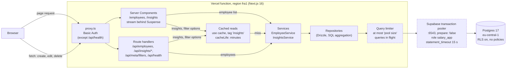
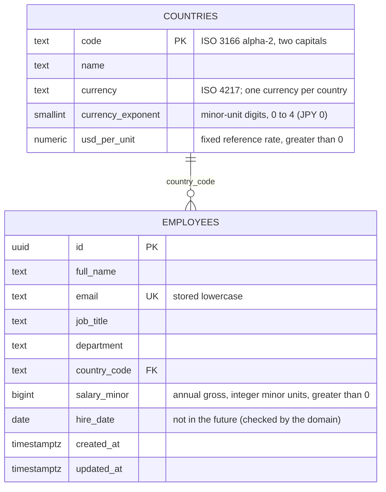
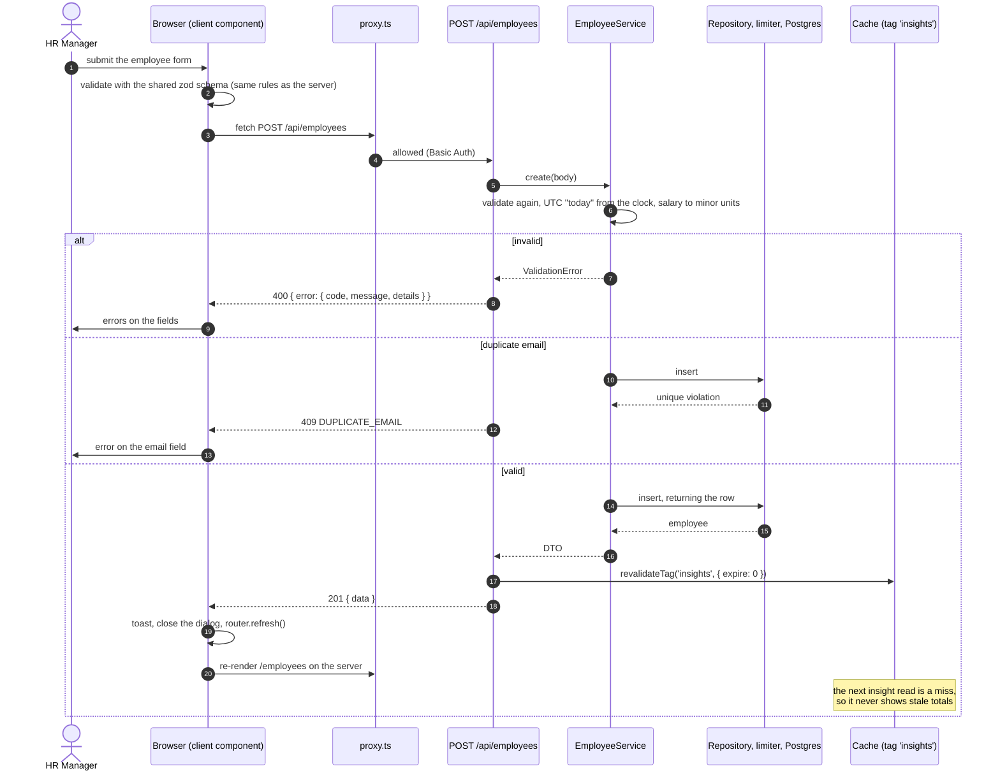
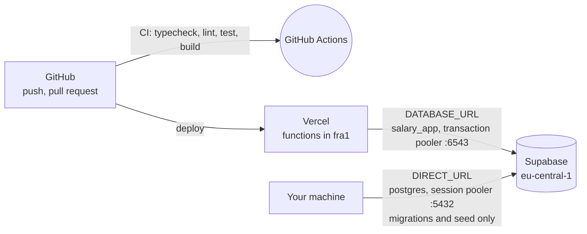

# Architecture

One Next.js 16 application (App Router) on Vercel, one Supabase Postgres database. No other infrastructure:
no queue, no separate backend, no external cache (see the reasons in [DECISIONS.md](DECISIONS.md)).

## Layers and rules

```
src/
  proxy.ts            Demo access protection (Basic Auth); not user authentication
  app/                Pages, layouts, route handlers: a THIN layer (no business logic)
    api/              parse -> validate -> call a service -> respond (about 10 lines each)
  server/             Framework-free: nothing here imports Next.js
    domain/           Types, zod schemas, money and currency, pure statistics. Depends on nothing.
    services/         Use cases: EmployeeService, InsightsService (repositories injected)
    repositories/     Interfaces + Drizzle implementations
    db/               schema, migrations, client, query limiter, seed
    http/             Errors -> HTTP mapping, Basic Auth logic
  components/ lib/    shadcn/ui primitives and client-safe helpers
tests/                unit, integration (PGlite), contract tests shared by fakes and the real thing
```

- **Dependency direction:** `app -> services -> repositories -> db`. `domain` depends on nothing.
- **Services get their repositories injected**, so unit tests use in-memory fakes and the same contract tests
  run against the fakes and against the real SQL on PGlite.
- **Server Components call services directly** for the first render (no HTTP hop). **Client components use the
  `/api` routes**, which are the only write path.
- **Heavy aggregation runs in SQL** (`GROUP BY`, `percentile_cont`), never by loading rows into JavaScript.
- **Money is an integer in minor units** in the employee's local currency; USD figures use fixed reference rates.

## 1. Request flow

Reads on a page, reads through the API, and writes all pass through the same layers. The dashed boxes are the
two resilience mechanisms that sit between the application and the database.



What each hop is for:

| Hop | Why it exists |
|---|---|
| `proxy.ts` | Keeps the public demo from being browsed or edited by whoever finds the URL. Off unless `BASIC_AUTH_*` is set. |
| Server Components | First paint with data already in it; table state lives in the URL, so every view is shareable. |
| Route handlers | The single write path and the public API; they validate with the shared zod schema and map errors to `{ error: { code, message, details? } }`. |
| Cached reads | Insights and filter options are cached under one tag; a hit costs about 3 ms, a miss one database round trip. |
| Query limiter | Through the transaction pooler, postgres.js hangs if it queues queries on a connection (ADR 19), so the queue is kept in the application. |
| `salary_app` + `statement_timeout` | A query that never returns would hold a limiter slot for ever; the server cancels it after 15 s (ADR 21). |

## 2. Data model

Two tables. Migrations are in `src/server/db/migrations`, the schema in `src/server/db/schema.ts`.



Indexes on `employees`, each there for a measured reason (`docs/PERFORMANCE.md`):

| Index | Serves |
|---|---|
| `(lower(full_name) collate "C", id)` | The default list order and name sort, identical on every database |
| `(hire_date, id)` | Sort by hire date, both directions |
| `(country_code)`, `(country_code, job_title)`, `(department)` | Filters, the per-country and per-department statistics |
| GIN trigram on `full_name` and on `email` | Search with `ILIKE '%term%'` |
| unique `(email)` | Duplicate detection (409) |

Security: row level security is enabled on both tables with **no policies**, which blocks Supabase's public REST
API; the app connects server-side as the least-privilege role `salary_app` (`BYPASSRLS`, no DDL, no `TRUNCATE`).
Migrations and the seed use `postgres` through the session pooler.

## 3. Write path and cache invalidation

Every change goes through the API, so there is one place that validates, writes and invalidates.



Update and delete follow the same path (`PATCH`, `DELETE`): validate, write, invalidate, then the client refreshes.
Edits always send `salary` and `countryCode` together (ADR 9), and a non-UUID id is "not found" inside the service.
Anything unexpected becomes a generic 500 and is logged on the server only; no SQL or stack trace reaches the client.

## Deployment



The production build needs no database and no secrets (every data-reading route renders at request time), which
CI checks by building with no environment variables. `DIRECT_URL` is never set on Vercel.
